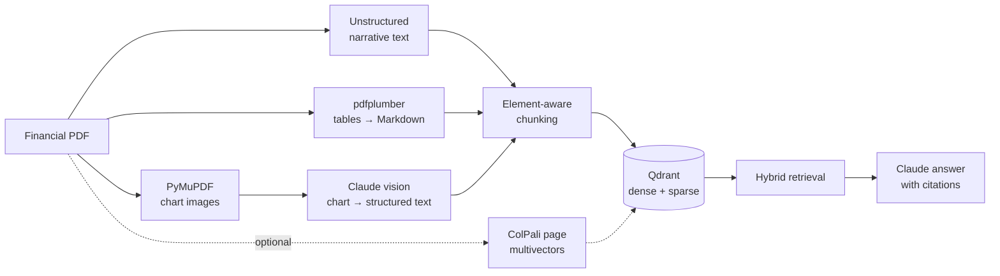

# Multi-Modal RAG for Financial Reports

A Retrieval-Augmented Generation pipeline for unstructured financial documents — the kind with narrative text, complex tables, **and** charts. Tables are extracted to Markdown, charts are converted into rich textual descriptions by Claude vision, and everything is retrievable through **hybrid search** (dense semantic + sparse BM25) in Qdrant. An optional ColPali path retrieves whole page images by visual layout, no OCR involved.

Built to demonstrate **dirty-data handling, advanced chunking strategies, and multi-modal embeddings**.

## Architecture



- **Parsing (dirty data).** Three extractors, each doing what it's best at: Unstructured partitions narrative text into typed elements (with a pdfplumber fallback), pdfplumber lifts tables into Markdown, and PyMuPDF extracts embedded figures — plus renders vector-drawing-heavy pages, since charts in real PDFs are often vector art invisible to image extraction.
- **Multi-modal step.** Every figure goes through Claude vision (`claude-opus-5`) and comes back as a structured `ChartDescription` (type, axes, key values, trend) via the SDK's `messages.parse()`. The description text is indexed, so *chart content is retrievable by keyword and meaning*.
- **Chunking strategy.** Element-aware: narrative text is sentence-split with overlap per page (exact page provenance survives), tables are indexed **whole** (splitting a table destroys it), chart descriptions are single chunks tied to their page.
- **Hybrid retrieval.** LlamaIndex `QdrantVectorStore` with `enable_hybrid=True`: dense vectors from `bge-small-en-v1.5` (fastembed — fully local, no API) fused with `Qdrant/bm25` sparse vectors at query time. Qdrant runs embedded (a local directory) — no server, no Docker.
- **Visual embeddings (optional).** The `[colpali]` extra adds late-interaction page retrieval: ColPali multivectors stored in Qdrant with a MaxSim comparator, querying page *layouts* directly.
- **Grounded answers.** Retrieved chunks become numbered context blocks with provenance; Claude returns a structured `RAGAnswer` with inline `[n]` citations mapped back to source pages, and an explicit `insufficient_context` flag instead of guessing.

## Setup

```bash
uv venv && source .venv/bin/activate
uv pip install -e . --group dev
export ANTHROPIC_API_KEY=sk-ant-...   # or `ant auth login`

# optional visual retrieval (pulls torch; ~3GB model download on first use)
uv pip install -e '.[colpali]'
```

## Usage

```bash
# Generate a synthetic financial report to play with
python scripts/make_sample_report.py sample_report.pdf

# Ingest: parse, describe charts with vision, build the hybrid index
finrag ingest sample_report.pdf            # add --no-vision to skip the LLM step
finrag ingest report.pdf --visual          # also build the ColPali page index

# Retrieve without generation
finrag search "gross margin by quarter"

# Ask with grounded, cited answers
finrag ask "What was Q2 2026 revenue and how does it compare to last year?"
finrag search-visual "revenue trend chart"  # ColPali page search
```

## Configuration

| Env var | Default | Purpose |
|---|---|---|
| `ANTHROPIC_API_KEY` | — | Claude API credentials (first-party backend) |
| `AWS_BEARER_TOKEN_BEDROCK` | — | Amazon Bedrock API key — used when no first-party credentials are set |
| `BEDROCK_REGION` | `us-east-1` | Bedrock region (also honors `AWS_REGION`) |
| `FINRAG_MODEL` | `claude-opus-5` | Vision + answer model |
| `FINRAG_FALLBACK_MODEL` | `claude-opus-4-8` | Retry model on safety refusal |
| `FINRAG_STORAGE_DIR` | `./storage` | Qdrant + image storage |
| `FINRAG_DENSE_MODEL` | `BAAI/bge-small-en-v1.5` | Local dense embeddings |
| `FINRAG_SPARSE_MODEL` | `Qdrant/bm25` | Sparse model for hybrid |
| `FINRAG_CHUNK_SIZE` / `_OVERLAP` | 512 / 64 | Narrative chunking |
| `FINRAG_TOP_K` | 6 | Retrieval depth |

**Backends.** With `ANTHROPIC_API_KEY` (or an `ant auth login` profile) the vision and answer steps call the first-party Claude API and use native structured outputs. With only `AWS_BEARER_TOKEN_BEDROCK` set they switch to Amazon Bedrock (`anthropic.`-prefixed model IDs) and get the same validated Pydantic results through a forced tool call, since Bedrock doesn't accept `output_config.format`. Vision content blocks work identically on both.

## Tests

Parsing, chunking, and **end-to-end hybrid retrieval run fully offline** (local embeddings + embedded Qdrant on a synthetic PDF built by the test suite); the vision and answer LLM steps are covered with mocks:

```bash
pytest
```

## Project layout

```
src/finrag/
├── parsing.py        # Unstructured + pdfplumber + PyMuPDF extraction
├── charts.py         # Claude vision: chart image → structured description
├── chunking.py       # element-aware chunking (tables whole, text split)
├── indexing.py       # Qdrant hybrid index via LlamaIndex + fastembed
├── retrieval.py      # dense+sparse hybrid retrieval
├── colpali_store.py  # optional ColPali page-image multivector path
├── answer.py         # cited answer synthesis (structured outputs)
├── llm.py            # Anthropic SDK wrapper: vision blocks, refusal fallback, Claude API + Bedrock backends
└── cli.py            # finrag ingest / search / ask / search-visual
```

## Scope notes

- The ColPali path is optional because it drags in torch and a ~3GB checkpoint; the core pipeline stays light and CPU-only.
- Chart descriptions are generated once at ingest time and cached in the index — query-time cost is retrieval + one generation call.
- The synthetic sample report (`scripts/make_sample_report.py`) exists so the pipeline can be demoed and tested without redistributing real filings; it works the same on real 10-K/10-Q PDFs.
