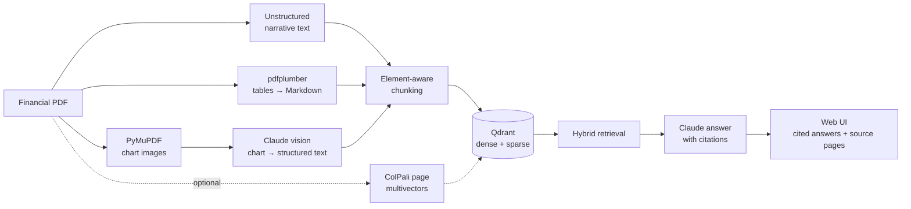

# Multi-Modal RAG for Financial Reports

A Retrieval-Augmented Generation pipeline for unstructured financial documents — the kind with narrative text, complex tables, **and** charts. Tables are extracted to Markdown, charts are converted into rich textual descriptions by Claude vision, and everything is retrievable through **hybrid search** (dense semantic + sparse BM25) in Qdrant. An optional ColPali path retrieves whole page images by visual layout, no OCR involved.

Built to demonstrate **dirty-data handling, advanced chunking strategies, and multi-modal embeddings**.

## Architecture



- **Parsing (dirty data).** Three extractors, each doing what it's best at: Unstructured partitions narrative text into typed elements (with a pdfplumber fallback), pdfplumber lifts ruled tables into Markdown (unruled financial statements, where the grid detector comes back mostly empty, are rebuilt from text rows: a period header such as `Q3-2025` or `30-Sep-25`, then label + numeric values, with footnote markers and footer page numbers kept out of the numbers), and PyMuPDF extracts embedded figures — plus renders vector-drawing-heavy pages, since charts in real PDFs are often vector art invisible to image extraction.
- **Multi-modal step.** Every figure goes through Claude vision (`claude-opus-5`) and comes back as a structured `ChartDescription` (type, axes, key values, trend) via the SDK's `messages.parse()`. The description text is indexed, so *chart content is retrievable by keyword and meaning*. Figures are downscaled to a 1568 px long side before the call (full-page photo spreads in real filings run 6–12 MB, over the API's 5 MB image limit). Photos and logos (`chart_type` "other") are left out of the index, and a figure the API rejects is skipped and reported instead of failing the whole ingest.
- **Chunking strategy.** Element-aware: narrative text is sentence-split with overlap per page (exact page provenance survives), tables are indexed **whole** (splitting a table destroys it), chart descriptions are single chunks tied to their page.
- **Hybrid retrieval.** LlamaIndex `QdrantVectorStore` with `enable_hybrid=True`: dense vectors from `bge-small-en-v1.5` (fastembed — fully local, no API) fused with `Qdrant/bm25` sparse vectors at query time. Qdrant runs embedded (a local directory) — no server, no Docker.
- **Visual embeddings (optional).** The `[colpali]` extra adds late-interaction page retrieval: ColPali multivectors stored in Qdrant with a MaxSim comparator, querying page *layouts* directly.
- **Grounded answers.** Retrieved chunks become numbered context blocks with provenance; Claude returns a structured `RAGAnswer` with inline `[n]` citations mapped back to source pages, and an explicit `insufficient_context` flag instead of guessing.

## Setup

```bash
uv venv && source .venv/bin/activate
uv pip install -e . --group dev
export ANTHROPIC_API_KEY=sk-ant-...   # or `ant auth login`

# optional visual retrieval (pulls torch; ~3GB model download on first use)
uv pip install -e '.[colpali]'
```

## Usage

```bash
# Generate a synthetic financial report to play with
python scripts/make_sample_report.py sample_report.pdf

# Ingest: parse, describe charts with vision, build the hybrid index
finrag ingest sample_report.pdf            # add --no-vision to skip the LLM step
finrag ingest report.pdf --visual          # also build the ColPali page index

# Retrieve without generation
finrag search "gross margin by quarter"

# Ask with grounded, cited answers
finrag ask "What was Q2 2026 revenue and how does it compare to last year?"
finrag search-visual "revenue trend chart"  # ColPali page search
```

## Web UI

```bash
finrag serve                 # http://127.0.0.1:8000
finrag serve --port 9000 --host 0.0.0.0
```

A single-page app served by the same process (FastAPI, no Node build step):

- **Add a report.** Drag a PDF in. Ingestion runs in the background with live progress: parsing, describing each figure with Claude vision (toggle it off to skip the LLM step), then indexing.
- **Ask.** Answers come back with inline `[n]` citation chips. Each chip opens the retrieved chunk (tables rendered as tables) beside an image of the exact source page, with a link to the PDF at that page. Chunks that were retrieved but not cited are listed separately, and an `insufficient_context` answer is flagged rather than presented as fact.
- **Search.** Hybrid dense + BM25 results with scores and element types (text, table, chart), with no LLM call.
- **Documents.** Pages, chunks, tables and described charts per report; deleting a report removes its chunks from Qdrant.

Without Claude credentials the UI still works for upload (text and tables only) and search; Ask is disabled and says why.

| Endpoint | Purpose |
|---|---|
| `GET /api/status` | LLM backend, models, document count |
| `GET /api/documents` · `POST /api/documents` | List reports · upload a PDF (`file`, `vision`), returns a job |
| `GET /api/jobs/{id}` | Ingestion progress |
| `DELETE /api/documents/{name}` | Remove a report and its chunks |
| `GET /api/documents/{name}/pages/{n}.png` · `/file` | Rendered source page · original PDF |
| `POST /api/search` | `{query, top_k}` → ranked chunks |
| `POST /api/ask` | `{question, top_k}` → answer, cited block numbers, full context |

Interactive API docs are at `/docs`. The server owns the embedded Qdrant directory, so stop it before running `finrag ingest` from the CLI against the same storage. Reports ingested from the CLI are searchable in the UI but don't appear in its document list or page viewer, because the server keeps its own copy of each uploaded PDF.

## Configuration

| Env var | Default | Purpose |
|---|---|---|
| `ANTHROPIC_API_KEY` | — | Claude API credentials (first-party backend) |
| `AWS_BEARER_TOKEN_BEDROCK` | — | Amazon Bedrock API key — used when no first-party credentials are set |
| `BEDROCK_REGION` | `us-east-1` | Bedrock region (also honors `AWS_REGION`) |
| `FINRAG_MODEL` | `claude-opus-5` | Vision + answer model |
| `FINRAG_FALLBACK_MODEL` | `claude-opus-4-8` | Retry model on safety refusal |
| `FINRAG_STORAGE_DIR` | `./storage` | Qdrant + image storage |
| `FINRAG_DENSE_MODEL` | `BAAI/bge-small-en-v1.5` | Local dense embeddings |
| `FINRAG_SPARSE_MODEL` | `Qdrant/bm25` | Sparse model for hybrid |
| `FINRAG_CHUNK_SIZE` / `_OVERLAP` | 512 / 64 | Narrative chunking |
| `FINRAG_TOP_K` | 6 | Retrieval depth |
| `FINRAG_MAX_UPLOAD_MB` | 50 | Web upload size limit |

**Backends.** With `ANTHROPIC_API_KEY` (or an `ant auth login` profile) the vision and answer steps call the first-party Claude API and use native structured outputs. With only `AWS_BEARER_TOKEN_BEDROCK` set they switch to Amazon Bedrock (`anthropic.`-prefixed model IDs) and get the same validated Pydantic results through a forced tool call, since Bedrock doesn't accept `output_config.format`. Vision content blocks work identically on both.

## Tests

Parsing, chunking, and **end-to-end hybrid retrieval run fully offline** (local embeddings + embedded Qdrant on a synthetic PDF built by the test suite); the vision and answer LLM steps are covered with mocks. The web API has an end-to-end test (upload, ingest, search, ask, page image, delete) on the same offline stack:

```bash
pytest
```

## Evaluation

`eval/` scores a running server against questions with known answers. `eval/custodian_q3.json` has 30 questions on two real filings, Custodian Investment Plc's Q3 2026 and Q3 2025 statements (public, from the company's Financials page): 27 figures copied from the reports' executive summaries, each with the pages that print it (found by searching every page for the exact figure), plus 3 questions the reports can't answer.

```bash
python eval/build_custodian.py path/to/pdfs          # rebuild the set from the two PDFs
finrag serve                                          # with both reports uploaded
python eval/run_eval.py eval/custodian_q3.json --top-k 20 --scope            # retrieval only, no LLM calls
python eval/run_eval.py eval/custodian_q3.json --top-k 20 --scope --answers  # also score answers
```

It reports retrieval hit rate (a retrieved chunk is on a page that prints the figure), answer accuracy (the figure is stated, 0.5% tolerance across thousands/millions/billions and naira/kobo, or the answer says the reports don't cover it) and citation accuracy.

| Setting | Retrieval hit | Correct figure | Correct citation |
|---|---|---|---|
| 6 chunks, all reports | 56% | 53% | 56% |
| 20 chunks, limited to the question's report (`documents`) | 93% | 80% | 93% |

Median answer time was about the same (5.2 s vs 5.7 s). The misses were "the context doesn't show it", never a wrong figure; most came from statement tables without grid lines, which the parser now rebuilds so each label keeps its numbers.

## Project layout

```
src/finrag/
├── parsing.py        # Unstructured + pdfplumber + PyMuPDF extraction
├── charts.py         # Claude vision: chart image → structured description
├── chunking.py       # element-aware chunking (tables whole, text split)
├── indexing.py       # Qdrant hybrid index via LlamaIndex + fastembed
├── retrieval.py      # dense+sparse hybrid retrieval
├── colpali_store.py  # optional ColPali page-image multivector path
├── answer.py         # cited answer synthesis (structured outputs)
├── llm.py            # Anthropic SDK wrapper: vision blocks, refusal fallback, Claude API + Bedrock backends
├── server.py         # FastAPI JSON API + background ingestion for the web UI
├── web/              # single-page UI (index.html, app.js, styles.css)
└── cli.py            # finrag ingest / search / ask / search-visual / serve
```

## Scope notes

- The ColPali path is optional because it drags in torch and a ~3GB checkpoint; the core pipeline stays light and CPU-only.
- Chart descriptions are generated once at ingest time and cached in the index — query-time cost is retrieval + one generation call.
- The synthetic sample report (`scripts/make_sample_report.py`) exists so the pipeline can be demoed and tested without redistributing real filings; it works the same on real 10-K/10-Q PDFs.
